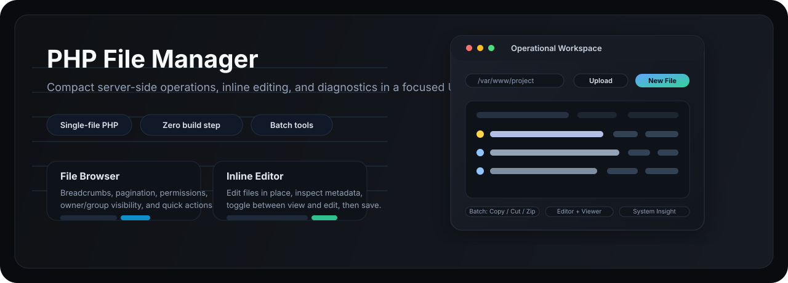
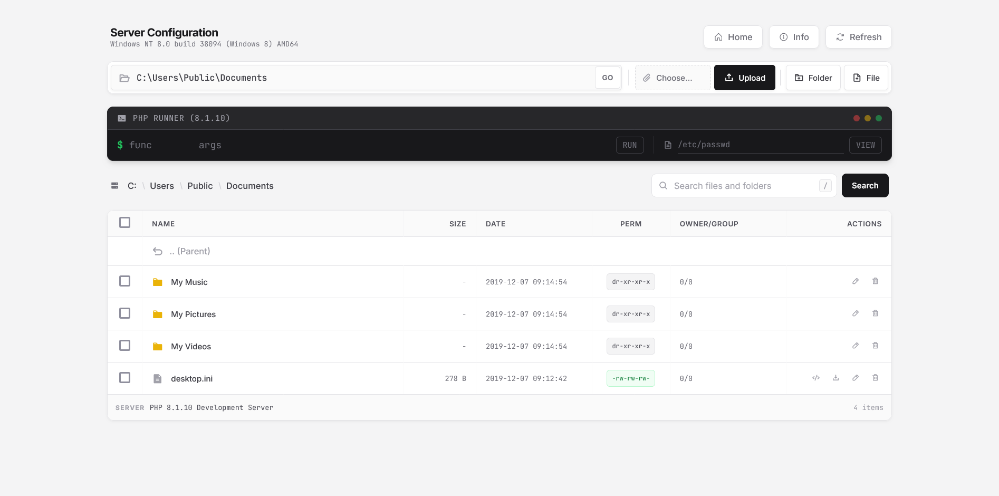
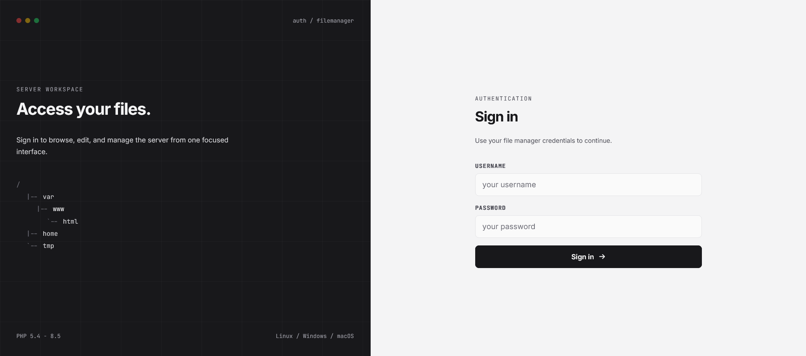

# PHP File Manager

<p align="center">
  
</p>

<p align="center">
  <a href="https://www.php.net/">
    
  </a>
  <a href="https://www.php.net/manual/en/install.php">
    
  </a>
  <a href="https://tailwindcss.com/">
    
  </a>
  <a href="https://www.php.net/manual/en/install.php">
    
  </a>
  <a href="https://developer.mozilla.org/en-US/docs/Learn/CSS/CSS_layout/Responsive_Design">
    
  </a>
</p>

<p align="center">
  Compact server-side file operations, inline editing, search, resilient uploads, and diagnostics in a focused single-file PHP interface.
</p>

<p align="center">
  <code>Single-file core</code>
  <code>No build step</code>
  <code>Chunked uploads</code>
  <code>Batch operations</code>
  <code>Built-in diagnostics</code>
  <code>Optional login</code>
  <code>Mobile + desktop</code>
</p>

## Screenshot

<p align="center">
  
</p>

<p align="center">
  <sub>File browser with search, upload controls, PHP runner, permission overview, and system diagnostics.</sub>
</p>

<p align="center">
  
</p>

<p align="center">
  <sub>Optional login screen using the split-console layout. The interface is responsive on desktop and mobile.</sub>
</p>

## Overview

This project is a compact PHP file manager for practical day-to-day server work: browsing directories, editing files, moving data around, searching large folders, checking system details, and running lightweight PHP-side function calls without leaving the interface.

The current build is fully self-contained in `filemanager.php`. Tailwind CSS is compiled inline, the client-side interaction code is embedded, and there is no build step or extra JavaScript bundle to deploy. Only Phosphor icons and Google Fonts are loaded from external CDNs.

Authentication is optional. By default the file manager opens directly, which suits local or trusted use. A session-based login can be enabled from the config block at the top of the file. Both the file manager and the login screen are responsive on desktop and mobile.

## Feature Set

| Area | Included |
| --- | --- |
| Navigation | Home shortcut, root/parent traversal, breadcrumb navigation with automatic collapse, pagination |
| Search | Per-directory name search, clear action, `/` keyboard shortcut, query preservation across actions |
| File operations | Upload, download, create file, create directory, rename, delete |
| Upload pipeline | Direct multipart, base64, raw body, and chunked uploads with automatic fallback and progress panel |
| Editor | Inline text editor, view/edit mode toggle, base64-encoded save transport, file metadata display |
| Metadata | Validated permission changes (`chmod`), timestamp editing, owner/group visibility |
| Batch tools | Multi-select delete, copy, cut, paste across directories, archive download |
| Compression | `ZipArchive`, `PharData`, and shell archiver fallback (`tar` / `zip`) |
| Diagnostics | PHP version, server software, disabled functions, cURL/database visibility |
| System insight | OS details, available binaries, storage usage, mount overview, hosts file preview |
| Runtime helper | Embedded PHP function runner with function-name validation and local form persistence |
| UX details | Toast feedback, persistent clipboard state, modal auto-focus, responsive compact layout |
| Authentication | Optional session login, disabled by default; configurable username/password; logout when enabled |
| Responsive UI | Desktop and mobile layouts for the file manager and login screen |

## Interface Modules

### 1. File Browser and Search

- Directory listing with folders first, then files
- Permission, owner/group, size, and modified-date visibility
- Search files and folders inside the current directory
- Breadcrumb path with automatic collapse for long paths
- Quick actions for edit, download, rename, delete, permissions, and date changes
- Bulk selection bar for copy, cut, compress, and delete

### 2. Upload Pipeline

- Small files go through direct multipart upload with progress
- Medium files fall back to base64 upload when needed
- Large files use raw-body or chunked uploads with retry handling
- Upload limits and chunk size adapt to the server's `post_max_size`
- Temporary chunk files are cleaned up automatically
- A progress panel reports status, percentage, filename, and errors

### 3. Inline Editor

- Opens files directly inside the same interface
- Shows file size, ownership, permission string, and timestamps
- Supports fast switching between `View` and `Edit`
- Saves through the same PHP endpoint without a separate API layer
- Uses base64 transport for file writes

### 4. PHP Runner

- Executes PHP functions with a single argument from the UI
- Validates the function name before execution
- Keeps the last function name and arguments in `localStorage`
- Useful for lightweight environment inspection or quick one-off calls

### 5. System Information Panel

- Web/PHP overview
- OS and binary visibility
- Security and permission context
- Storage usage and mount table
- Hosts file preview when readable

### 6. Authentication

- Disabled by default, so local installs open straight into the file manager
- When enabled, shows a split-console login screen with session-based login
- Default credentials are `fm_admin` / `fm_password`
- Passwords are compared as plain text by design; no hashing is applied
- A Logout action appears in the header while auth is enabled
- Works across the same PHP 5.4 - 8.5 range as the rest of the application

## Deployment Footprint

Runtime deployment needs only this file:

```text
filemanager.php
```

There is no `style.min.js`, no asset build, and no database setup. Optional repository files such as `README.md`, `assets/`, and local backup snapshots are not required on the target server. Authentication settings live in the same PHP file, so enabling login does not add runtime files.

## Quick Start

1. Upload `filemanager.php` to a PHP-enabled directory.
2. Open it in the browser.
3. Make sure the PHP process has the read/write permissions you intend for the directories you manage.
4. Optional: enable authentication by setting `$fm_auth_enabled = true;` and changing the default credentials.

## Authentication

Authentication is optional and disabled by default. With the default config, opening `filemanager.php` goes straight to the file manager, which is intended for local or trusted use.

Authentication settings at the top of `filemanager.php` (defaults shown):

```php
$fm_auth_enabled = false;
$fm_auth_user = 'fm_admin';
$fm_auth_pass = 'fm_password';
```

The username and password are only used when `$fm_auth_enabled` is set to `true`.

| Variable | Default | Purpose |
| --- | --- | --- |
| `$fm_auth_enabled` | `false` | Set to `true` to require login |
| `$fm_auth_user` | `fm_admin` | Login username |
| `$fm_auth_pass` | `fm_password` | Login password (plain text) |

- Change both credentials before enabling auth on a reachable server
- Passwords are stored and compared as plain text by design; no hashing is applied
- Login is session-based; a Logout action appears in the header while auth is enabled
- The login screen is responsive on desktop and mobile
- If the tool is exposed beyond localhost, use HTTPS and strong credentials

## PHP Compatibility

Supported range: **PHP 5.4 through 8.5**.

- No Composer dependencies or build step
- PHP 5.4-compatible syntax with guarded fallbacks for newer features
- Core file operations work without optional extensions
- Archive creation uses `zip` (`ZipArchive`), `phar` (`PharData`), or shell `tar` / `zip` when available
- `mbstring` is optional and improves multibyte search and name handling
- Authentication uses the same PHP 5.4-compatible session and string functions

## Runtime Notes

| Topic | Notes |
| --- | --- |
| PHP | PHP 5.4 through 8.5; single-file application without a framework, database, or build step |
| UI assets | Tailwind CSS output and client-side JavaScript are embedded in the PHP file |
| External assets | Phosphor Icons CSS (regular, bold, fill) and Google Fonts are loaded from CDNs |
| Upload flow | Falls back through direct, base64, raw, and chunked upload methods as needed |
| Chunk storage | Temporary chunks live under the system temp directory and are cleaned up over time |
| Search | Matches file and folder names in the current directory, limited to 200 characters |
| Clipboard | Copy/cut state is stored in `localStorage`, so it survives directory navigation |
| Pagination | Directory listings are paginated in blocks of 500 items |
| Compression | Uses the best available method: `ZipArchive`, `PharData`, then shell `tar` / `zip` |
| Validation | File and folder names, permission modes, and timestamps are validated before use |
| Authentication | Optional; disabled by default. When enabled, uses PHP sessions and plain-text credential comparison |
| Default credentials | `fm_admin` / `fm_password` when authentication is enabled |
| Session | `FMSESSID` session cookie; HttpOnly, SameSite=Lax, Secure on HTTPS; logout destroys the session |
| Responsive | Desktop and mobile layouts are supported for both the file manager and login screen |
| Platform awareness | Handles both Linux-style and Windows-style environments where possible |

## Repository Layout

```text
.
|-- filemanager.php   # Single-file application: PHP, CSS, and UI JavaScript
|-- README.md
|-- assets/
|   |-- login.png
|   |-- overview.svg
|   `-- screenshot.png
|-- login-mockups/    # Static login design references, not required at runtime
`-- backup/           # Local snapshots, not required at runtime
```

## Intended Use

This is a high-trust operational tool. It can read and modify files, change permissions and timestamps, build archives, and call PHP functions directly from the interface. It is best suited for controlled admin, maintenance, lab, or internal tooling environments where that level of capability is intentional.

Authentication is off by default for local convenience. Enable it before exposing the tool to anyone other than yourself.

## Summary

The project keeps the deployment model as small as possible while covering the workflows that matter most in a real file manager:

- single-file deployment
- optional session authentication
- responsive desktop and mobile layouts
- search-first navigation
- resilient uploads for different server limits
- reliable file operations
- inline editing
- server and storage inspection
- practical batch actions

It is optimized for utility first, with a compact UI that stays readable during repetitive operational work.
